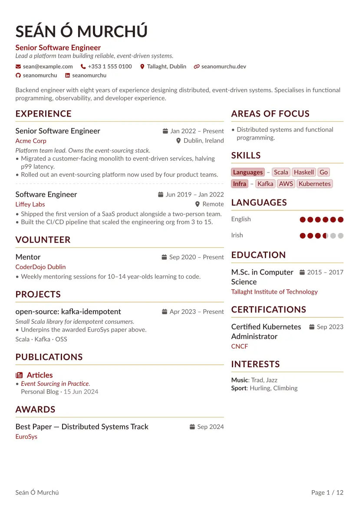

<h1 align="center">Alta CV</h1>

<p align="center">
  <a href="https://typst.app/universe/package/altacv"></a>
  <a href="https://github.com/smur89/alta-typst/releases"></a>
  <a href="https://github.com/smur89/alta-typst/actions/workflows/build.yml"></a>
  <a href="LICENSE"></a>
  <a href="https://github.com/smur89/alta-typst/stargazers"></a>
</p>

<p align="center">A two-column CV template for Typst, inspired by LianTze Lim's <a href="https://github.com/liantze/AltaCV">AltaCV</a> (LaTeX).<br>Write your CV once as <a href="https://jsonresume.org/">JSON Resume</a> data; pick a theme, a layout and a language.</p>

<!-- Relative path so the preview tracks the codebase: GitHub renders the README from main, Universe from the package version's snapshot. examples/ ships in the typst/packages submission but is `exclude`d from the compiler bundle (see typst.toml). -->
<p align="center">
  
</p>
<p align="center"><sub>One CV in every built-in theme, each frame with a different layout: columns, photo position and shape, header alignment, date format, QR code, justified text, single column, a CV in Irish, and show rules restyling the ratings and keywords.</sub></p>

## Highlights

- **Data, not layout.** Your CV is a [JSON Resume](https://jsonresume.org/schema/) dict, inline in Typst or loaded from a `resume.json`. Empty sections disappear, and a misspelt key or a wrong type stops the build with a message naming it.
- **Built-in themes**, every colour role overridable, plus theme tokens for the font, type scale, spacing and separators.
- **Any layout.** Two columns at any ratio, any section in either column, the side panel left or right, or a single column for applicant-tracking systems (ATS).
- **A rich header.** Photo (circle, rounded or square; left, right or centred), contact bar with icons for common networks, and an optional QR code to your homepage for printed copies.
- **Ratings as dots.** Language fluency and skill levels from LinkedIn-style terms (`Native`, `Expert`) or exact numbers, in half-dot steps.
- **Every string translatable**, including month names. The labels follow `set text(lang: ..)`, with English and [Irish](internal/data/labels-ga.toml) built in.
- **Print- and archive-ready.** PDF metadata comes from your data, and the output compiles as PDF/A and PDF/UA-1 (tagged, with alt text).

The full example, every section in use, over two pages ([source](https://github.com/smur89/alta-typst/blob/v1.8.0/examples/example-full.typ) <!-- x-release-please-version -->, [PDF](examples/example_full.pdf)):

| Page 1 | Page 2 |
| :---: | :---: |
|  |  |

## Contents

- [Quick start](#quick-start): [your own mapping](#your-own-mapping)
- [Customising](#customising): [themes](#themes-and-colours), [fonts](#fonts), [layout](#layout), [photo and contacts](#photo-contact-bar-and-qr-code), [translation](#translating-labels), [restyling](#restyling-parts), [PDF output](#pdf-metadata-pdfa-and-accessibility)
- [Reference](#reference): [data schema](#data-schema), [preferences](#preferences), [theme tokens](#theme-tokens), [labels](#labels), [part labels](#part-labels), [exports](#exports)
- [Contributing](#contributing) · [Credits](#credits) · [License](#license)

## Quick start

### Requirements

- **Typst 0.15.0** or later.
- **Fonts:** [Lato](https://fonts.google.com/specimen/Lato) (the default font) and the **FontAwesome 7 desktop** fonts (for icons). The Typst web app has both. Locally:

  ```bash
  # macOS (Homebrew)
  brew install --cask font-lato font-fontawesome
  ```

  Elsewhere, install Lato from Google Fonts and the FontAwesome 7 desktop OTFs from [fontawesome.com/download](https://fontawesome.com/download). Debian/Ubuntu's `fonts-font-awesome` is v6, which isn't read. Run `typst fonts` to check: without FontAwesome, icons render as empty boxes.

Package dependencies download automatically.

### Start a new CV

```bash
typst init @preview/altacv
```

This copies [`template/cv.typ`](template/cv.typ), a complete example CV, and [`template/resume.json`](template/resume.json), the same CV as a [JSON Resume](https://jsonresume.org/) file, into a new project. Edit the data in `cv.typ` in place and compile. To load `resume.json` instead, replace `cv.typ`'s `#alta(cv, preferences: preferences)` call with the `alta-from-json` line commented below it. That drops the photo, which `cv.typ` sets in Typst.

### Render an existing `resume.json`

<!-- x-release-please-start-version -->
```typst
#import "@preview/altacv:1.8.0": alta-from-json, altacv

#show: altacv.with()

#alta-from-json(path("resume.json"))
```
<!-- x-release-please-end -->

The file is validated against the [JSON Resume schema](https://jsonresume.org/schema/) first, so a vanilla `resume.json` works without edits. Both routes take the same data: anything an inline dict can hold, altacv's [extensions](#extensions) included, a `resume.json` can too. Dates must be ISO 8601 (`2024`, `2024-06`, `2024-06-15`). To inspect or change the data before rendering, parse it yourself with `from-json-resume`:

<!-- x-release-please-start-version -->
```typst
#import "@preview/altacv:1.8.0": alta, altacv, from-json-resume, themes

#show: altacv.with(theme: themes.forest)

#alta(from-json-resume(path("resume.json")))
```
<!-- x-release-please-end -->


### Write the data in Typst

<!-- x-release-please-start-version -->
```typst
#import "@preview/altacv:1.8.0": alta, altacv

#let cv = (
  basics: (
    name: "Jane Doe",
    label: "Senior Software Engineer",
    summary: [Backend engineer with eight years' experience…],
    email: "jane@example.com",
    phone: "+353 1 555 0100",
    location: "Dublin, Ireland",
    url: "https://janedoe.dev",
    profiles: (
      (network: "GitHub",   username: "janedoe", url: "https://github.com/janedoe"),
      (network: "LinkedIn", username: "janedoe", url: "https://linkedin.com/in/janedoe"),
    ),
  ),
  work: (
    (
      position: "Senior Software Engineer",
      name: "Acme Corp",
      url: "https://acme.example.com",  // links the company name
      location: "Dublin, Ireland",
      startDate: "2022-01",             // no endDate: "Present"
      highlights: ([Led the migration…], [Designed the platform…]),
      keywords: ("Python", "Go", "Rust"),
    ),
  ),
  skills: (
    (name: "Languages", level: "Expert", keywords: ("Scala", "Python")),
    (name: "Infra",     keywords: ("Kafka", "AWS", "Kubernetes")),
  ),
  languages: (
    (language: "English", fluency: "Native"),
    (language: "Irish",   fluency: "Professional Working"),
  ),
  // education, projects, publications, certificates, awards, …
)

#show: altacv.with()

#alta(cv)
```
<!-- x-release-please-end -->

Your own `set` and `show` rules go between the two lines and win. Only `basics.name` is required. Fields that take "string or content" also accept Typst markup (`[Led the *platform* team]`); keep to plain strings if the data also lives in a `resume.json`, as JSON can't carry markup. The [data schema](#data-schema) lists every section and field.

### Write the CV in markup

<!-- x-release-please-start-version -->
```typst
#import "@preview/altacv:1.8.0": altacv, contact, cv-columns, cv-header, entry, skills

#set document(title: "Jane Doe", author: "Jane Doe")
#show: altacv.with()

#cv-header(
  tagline: "Senior Software Engineer",
  contacts: (contact("email", "jane@example.com", url: "mailto:jane@example.com"),),
)

#cv-columns(
  ratio: 2 / 3,
  [
    = Experience

    #entry(title: "Senior Software Engineer", org: "Acme Corp", date: "2022 – Present")[
      - Led the migration…
    ]
  ],
  [
    = Skills

    #skills("Languages", ("Scala", "Python"), level: "Expert")
  ],
)
```
<!-- x-release-please-end -->

The structure is Typst's own: the name is the document's `title` (from `set document(title: ..)`), `=` headings are sections, `==` headings are groups, and entries sit below them; the template styles it. `cv-columns` lays out the two columns as `alta()` does, with the theme's gutter; a plain Typst `grid` works too (set its `column-gutter`), as does a full-width row below. [`tests/markup.typ`](https://github.com/smur89/alta-typst/blob/v1.8.0/tests/markup.typ) <!-- x-release-please-version --> is a complete CV written this way; the blocks are under [Exports](#exports).

A few things to know:

- A `===` heading isn't styled as a group, and an `entry` under one panics.
- An `entry` right after `#alta(cv)` continues its last section; start your own with `= ...`.
- An `entry` doesn't break across pages: it moves to the next one whole, so one taller than a page overflows it. Split long prose over several entries.
- A `publication` without a `url` links its title to its first DOI, arXiv or PMID identifier.
- Group headings in markup carry no icon, where `alta()`'s publication and project groups do. Add one yourself: `== #icon("microphone") Talks`.
- Numbering a heading (`set heading(numbering: ..)`) numbers the outline but not the title as drawn.
- Use `outline(depth: 1)` to list sections only, as entries are headings too.

### Your own mapping

Inside the template, `alta(cv)` draws the CV with [`adapter/json-resume.typ`](https://github.com/smur89/alta-typst/blob/v1.8.0/adapter/json-resume.typ) <!-- x-release-please-version -->: a mapping from the JSON Resume schema onto the public blocks (`cv-header`, `entry`, `publication`, `skills`, `rating`, `label-row`), written to be copied. To change how a part of the CV is drawn beyond what the preferences and show rules reach, copy it into your project as `json-resume.typ` and replace its `#import` lines with one:

<!-- x-release-please-start-version -->
```typst
#import "@preview/altacv:1.8.0": adapter, cv-columns, cv-header, divider, entry, icon, label-row, maps-providers, publication, rating, skills
```

Then render your copy under the template, and edit it from there:

```typst
#import "@preview/altacv:1.8.0": altacv
#import "json-resume.typ": resume

#show: altacv
#let cv = json("resume.json")
#set document(title: cv.basics.name, author: cv.basics.name)
#resume(cv)
```
<!-- x-release-please-end -->

`resume(cv, labels: auto, preferences: (:))` takes `alta()`'s kebab-case labels and preferences; a missing one reads `alta()`'s default, and the labels are the document language's. The `set document` fills the PDF's metadata, which `alta()` does for you. A bare `basics.image` path resolves from your copy's folder.

The mapping reads the CV with the `adapter` helpers, the same readers `alta()` uses, so your copy reads the data as `alta()` does:

- `adapter.format-date(value, format:, months:)`: a JSON Resume date as `alta()` shows it (`"2024-06"` reads `"Jun 2024"`).
- `adapter.location-text(location)`: a location's city, region and country code, for you to join.
- `adapter.basics-contacts(basics, linked:, maps-provider:, full-urls:, icons:)`: the contact bar's records from `basics`, for `cv-header(contacts: ..)`.
- `adapter.fluency-rating(entry, max:)`: a language's rating from its `custom.altacv.rating` or its `fluency` term, else `none`.
- `adapter.group-by-type(items)`: entries grouped by `type`, in the order each first appears.
- `adapter.labels(overrides:)`: the labels in the document's language, `overrides` over them, as `alta()` resolves them. Call it in `context`.

Two things changed in the template form when `alta()` moved onto the mapping. A multi-page CV can differ from before where a divider lands at the top of a page: the divider keeps its space there, its rule hidden, where `alta()` used to drop both. And a group heading's icon and the gap after it are in the heading's `em`, so the heading's text sits slightly further from its icon. Standalone `alta(cv)` is unchanged.

## Customising

Put `#show: altacv.with(theme: ..)` above the CV, then your own `set` and `show` rules: `#set page(paper: "us-letter")`, `#set text(font: "Inter", lang: "de")`, `#show heading: ..`. `alta(cv)` on its own still works as before; the template form replaces it in the next major release ([#239](https://github.com/smur89/alta-typst/issues/239)).

`alta()` takes the CV and two optional dicts, each merged over the defaults:

```typst
#alta(cv, labels: (:), preferences: (:))
```

Set only the keys you want to change. Option names are kebab-case (`column-ratio`), as Typst's own are; the camelCase spellings of earlier releases (`columnRatio`) still work but are deprecated. An unknown key or a wrong type panics with a message naming it. The full list is under [Preferences](#preferences) and [Labels](#labels). Inside the template, the document-level ones go to the template or a `set` rule instead: see [In the template](#in-the-template). The snippets below assume the `cv` dict and import from [Quick start](#write-the-data-in-typst); the common settings:

<!-- x-release-please-start-version -->
```typst
#import "@preview/altacv:1.8.0": alta, altacv, maps-providers, themes

#show: altacv.with(theme: themes.navy)
#set page(paper: "us-letter")

#alta(cv, preferences: (
  date-format: "short",              // 06/2024
  photo-position: left,
  link-contact-info: (phone: false),  // everything linked but the phone
  maps-provider: maps-providers.osm, // OpenStreetMap for basics.location
  right-column-sections: ("focus-areas", "education", "skills", "languages", "certificates"),
))
```
<!-- x-release-please-end -->

Settings layer in order: the theme, then your `set` and `show` rules after the show line, which win over it. Standalone `alta()` takes the theme, font, paper and footer as preferences instead ([In the template](#in-the-template) maps each).

### Themes and colours

The template's `theme` picks the look (`preferences.theme` standalone). The built-in themes are `themes.teal` (the default), `navy`, `crimson`, `forest`, `plum`, `charcoal`, `altacv`, `rust`, `bauhaus`, `riso`, `phosphor` and `catppuccin`.

To recolour a role, set it over the theme's colours:

```typst
#show: altacv.with(theme: themes.altacv + (colours: (..themes.altacv.colours, body: black)))
```

Standalone, `preferences.colours` does the same: `#alta(cv, preferences: (theme: themes.altacv, colours: (body: black)))`.

| Role | Colours |
|---|---|
| `accent` | Organisation names, tags, rating dots, contact icons, publication titles, the QR code. |
| `emphasis` | Entry titles and interest group names. |
| `body` | Body text and icons. Dates, dividers and empty rating dots take lighter shades of it. |
| `heading` | Section titles. |
| `heading-rule` | The rule under each section title. |
| `subheading` | Group titles, such as a publication type. |
| `name` | `basics.name`. |
| `tagline` | `basics.label`, under the name. |

Any `rgb(...)` value works; roles that colour text should stay dark enough to read on white.

A theme can also set the font, the type sizes and weights, the spacing and the separators. A theme of your own sets only what it changes; the rest comes from the default theme:

```typst
#show: altacv.with(theme: (
  font: "Libertinus Serif",
  type: (headline: (size: 1.2)),  // section titles
  separator: (facts: " | "),
))
```

To adjust a built-in theme, add to it: `themes.navy + (font: "Libertinus Serif")`. Typst's `+` merges only the top level, so `themes.navy + (colours: (accent: …))` replaces all of navy's colours; spread them to change a few, `(colours: (..themes.navy.colours, accent: …))`. Every token is listed under [Theme tokens](#theme-tokens).

### Fonts

Set the font family (or a fallback array) with `#set text(font: "Inter")` after the show line, over the theme's (`preferences.font` standalone). Any installed font works.

To set the name or headings in a different face, add a show rule after the show line. Inside the template, the name is Typst's `title` element (`show title: ..`) and section titles are level-1 headings (`show heading.where(level: 1): ..`); group and entry titles are deeper. Standalone `alta()` keeps the old levels, the name a level-1 heading and section titles level 2, until the next major release ([#239](https://github.com/smur89/alta-typst/issues/239)):

```typst
// A slab-serif name and section headings over a sans body:
#show: altacv.with()
#set text(font: "Source Sans 3")
#show selector(title).or(heading.where(level: 1)): set text(font: "Roboto Slab")
#alta(cv)
```

A plain `show heading: …` reaches group and entry titles too. Standalone, a `set text(font: …)` outside `alta()` doesn't change the body, as `alta()` sets the body's font, size, colour and language itself; other text settings (tracking, number styles, OpenType features) still apply.

### Layout

`preferences.column-ratio` is the left column's share of the page width. `left-column-sections` and `right-column-sections` choose which sections go where, in order; by default long-form sections (experience, projects, publications) take the wide left column and the rest the right (see [Page and layout](#page-and-layout)). A section left out of both isn't rendered, even when it has data.

Invert the layout, side panel on the narrow left:

```typst
#alta(cv, preferences: (
  column-ratio: 0.35,
  left-column-sections: ("focus-areas", "skills", "languages", "education", "certificates"),
  right-column-sections: ("work", "publications"),
))
```

**Single column.** `column-ratio: 1` stacks every section in one full-width column, left list first, then right. Useful for applicant-tracking systems that misread multi-column PDFs:

```typst
#alta(cv, preferences: (
  column-ratio: 1,
  left-column-sections: ("work", "education"),
  right-column-sections: ("skills", "languages", "certificates"),
))
```

Page size and margins are Typst's own: `#set page(paper: "us-letter", margin: (x: 1cm))` after the show line. For a footer with your name and page numbers on a document of more than one page, `#set page(footer: alta-footer())`; for the last-modified line, `alta-updated-footer()`, with `version: true` to add the version (in a CV written in markup, give it the date: `alta-updated-footer(date: "May 2026")`); or any content of your own. Standalone, these are the `paper`, `margin`, `page-footer`, `last-modified-footer` and `footer-version` preferences ([In the template](#in-the-template)).

### Photo, contact bar and QR code

**Photo.** Set `basics.image` to add one. Pass it as a `path()`, which resolves relative to your own file, or as bytes:

```typst
basics: (
  image: path("avatar.png"),                 // recommended
  // image: read("avatar.png", encoding: none),
  // image: "/avatar.png",                   // relative to the --root dir
  // image: avatar-placeholder,              // built-in silhouette; import it from the package
  // …other basics fields
)
```

A bare relative string without the leading `/` resolves inside the package, so use `path()`. [JSON Resume](https://jsonresume.org/schema/) calls for a URL here, but Typst can't fetch remote files: keep the image next to your CV.

Position it with `photo-position` (`right`, `left`, `top`, `bottom`), size it with `photo-size` and shape it with `photo-shape` (`"circle"`, `"rounded"`, `"square"`). Non-square images are cropped from the centre. `header-text-align` aligns the name and contact bar: `left`, `center` or `right`.

**Contact bar.** Built from `basics.email`, `phone`, `location`, `url` and `profiles`, each linked (`mailto:`, `tel:`, a maps search, the URL). `link-contact-info` turns linking off globally or per channel. For paper, turn linking off and set `print-full-urls: true` to print profile URLs in place of usernames.

**QR code.** For printed copies, `qr-code` adds a QR code to your homepage on the side opposite the photo:

```typst
#alta(cv, preferences: (qr-code: auto))                         // encodes basics.url
#alta(cv, preferences: (qr-code: "https://janedoe.dev/cv"))     // any URL
```

### Translating labels

Every string the template prints is a label, and the labels follow the document's language. Set it with Typst's own rule, before `#alta(...)`:

```typst
#set text(lang: "ga")
#alta(cv)
```

The language also drives hyphenation, smart quotes and the PDF's language tag. English and Irish labels are built in ([`example-ga.typ`](https://github.com/smur89/alta-typst/blob/v1.8.0/examples/example-ga.typ) <!-- x-release-please-version --> is a CV in Irish); any other language keeps the English ones. Override any subset with `labels`, over the language's own:

```typst
#set text(lang: "de")
#alta(cv, labels: (
  work:         "Berufserfahrung",
  skills:       "Kenntnisse",
  education:    "Ausbildung",
  present:      "Heute",
  months: ("Jan", "Feb", "Mär", "Apr", "Mai", "Jun", "Jul", "Aug", "Sep", "Okt", "Nov", "Dez"),
))
```

For a full translation, copy [`internal/data/labels-en.toml`](internal/data/labels-en.toml) next to your CV (say as `labels-de.toml`), translate the values, drop its `lang` line and load it: `#alta(cv, labels: toml("labels-de.toml"))`. To have it built in, open a pull request adding it as `internal/data/labels-de.toml`. Every key is under [Labels](#labels).

`labels.lang` is deprecated: it still sets the document's language, over `set text`, until the next major release ([#239](https://github.com/smur89/alta-typst/issues/239)).

### Restyling parts

Parts of the CV carry Typst labels (`<alta-…>`) that show rules can target, to restyle one part without touching the rest. Put the rules before `#alta(...)`:

```typst
#show <alta-contact>: set text(font: "IBM Plex Mono")
#show <alta-date>: set text(style: "italic")
#show divider: set line(stroke: (paint: gray))         // keeps the dash
#show <alta-rating-full>: [★]                          // stars for dots
#show <alta-rating-empty>: [☆]
#alta(cv)
```

A rule on a text part overrides the template's font, size, colour, weight, style or tracking for it, but not its icon (except a group title's, which follows the title's colour). The line parts take `set line(...)`. The line between entries is Typst's own [`divider`](https://typst.app/docs/reference/model/divider/), so restyle it as any divider, with `show divider`, as the example does. The marker parts (date and location icons, rating dots) can be recoloured or replaced; a replacement keeps the marker's place and alt text, and its glyph must be in one of your fonts. Rating dots also take `set circle(fill: …)`, and a glyph that replaces one takes its colour: the accent, or the border colour for an empty dot. A paragraph part, the line that lays out a row of items, takes `set par(…)`. Every part is listed under [Part labels](#part-labels), with its kind: the rules it takes, not the element it is. A replacement rule's `it` is the part as content, whatever builds it (text, a sequence, a `context`, an `align`), so use it whole (`tag(it)`, `emph(it)`), not `it.text`.

An entry's keywords (a project's stack, education's courses) are a line of text. To draw them as pills, replace each `<alta-keyword>` with a `tag()`, drop the separator between them, and space the `<alta-keywords>` line as skill rows are (0.8em, the default `keyword-row` gap) from its wrapped rows and the line above:

<!-- x-release-please-start-version -->
```typst
#import "@preview/altacv:1.8.0": alta, altacv, tag

#show: altacv.with(theme: (separator: (keywords: "")))
#show <alta-keyword>: it => tag(it)
#show <alta-keywords>: set par(leading: 0.8em, spacing: 0.8em)
#alta(cv)
```
<!-- x-release-please-end -->

The list bullet is Typst's `list`, so change it with a show-set rule: `#show list: set list(marker: [–])`. Standalone, a plain `#set list(...)` doesn't reach inside `alta()`; inside the template it does, after the show line.

### PDF metadata, PDF/A and accessibility

The PDF's document properties are filled from your data:

| PDF field | Source |
|---|---|
| Title | `labels.document-title` (default `"{name} — CV"`) |
| Author | `basics.name` |
| Subject | `basics.summary` |
| Keywords | Every `skills[].keywords`, de-duplicated, then `meta.canonical` and `meta.version` |
| Date | `meta.lastModified` (ISO 8601), else the compile time |

```typst
meta: (
  lastModified: "2026-06-12",               // PDF date; footer with last-modified-footer: true
  canonical: "https://example.com/cv.json", // PDF Keywords
  version: "v1.0.0",                        // PDF Keywords; footer with footer-version: true
)
```

For an archival (PDF/A) or accessible (PDF/UA-1) PDF, ask the compiler. The template needs no setting:

```sh
typst compile --pdf-standard a-2b,ua-1 cv.typ
```

The output has a tagged structure with nested headings, a document title, alt text for the photo and meaningful icons, and the language from `set text(lang: ..)`.

## Reference

### Data schema

The `cv` dict follows [JSON Resume](https://jsonresume.org/schema/). Missing or empty sections are skipped, with no orphan headings. Spec fields altacv doesn't render (`basics.pronouns`, which JSON Resume [is removing](https://github.com/jsonresume/jsonresume.org/pull/629); a location's `address` and `postalCode`) are accepted and ignored, so a `resume.json` from elsewhere compiles unchanged.

#### Top-level keys

`basics`, `objective`, `work`, `volunteer`, `education`, `skills`, `languages`, `projects`, `publications`, `certificates`, `awards`, `interests`, `references`, `custom` ([extensions](#extensions)), `meta` ([PDF metadata](#pdf-metadata-pdfa-and-accessibility)), `$schema` (accepted, not rendered), and the deprecated `focusAreas`. Any other key panics, so a misspelt section (`publication`) fails rather than vanishing.

`objective` ([JSON Resume](https://jsonresume.org/schema/) 1.4.0) is a short career goal, a string or content, shown in the header under the tagline (`basics.label`), in italics, aligned with the rest of the header.

#### Dates

ISO 8601 dates (`"2024"`, `"2024-06"`, `"2024-06-15"`) are formatted per `preferences.date-format`; other strings (`"Jan 2022"`) print as given. A missing or empty `endDate` reads `Present` (`labels.present`).

In Typst, a full date can also be a `datetime` (`datetime(year: 2024, month: 6, day: 15)`, or `datetime.today()`), read as its ISO string. A `datetime` always has a day, so a date known only to the month or year stays a string (`"2024-06"`).

#### Extensions

altacv reads four optional fields the [JSON Resume schema](https://jsonresume.org/schema/) has no place for, from its own namespace in the schema's `custom` object. Other keys under `custom` are ignored.

```typst
(
  custom: (altacv: (focusAreas: ([Distributed systems], [Developer tooling]))),
  languages: ((language: "German", fluency: "Fluent", custom: (altacv: (rating: 3.5))),),
  skills: ((name: "Frontend", keywords: ("React",), custom: (altacv: (rating: 2.5))),),
  awards: ((title: "Best Paper", custom: (altacv: (url: "https://example.com/paper"))),),
)
```

| Field | Effect |
|---|---|
| `custom.altacv.focusAreas` (root) | An "Areas of Focus" section of prose bullets. Its section key and label are `focus-areas`. |
| `languages[].custom.altacv.rating` | An exact rating, 0 to `preferences.max-rating` in 0.5 steps; wins over `fluency`. |
| `skills[].custom.altacv.rating` | The same for a skill group; wins over `level`. |
| `awards[].custom.altacv.url` | Links the award title. |

**Deprecated:** the top-level `focusAreas`, `languages[].rating` and `awards[].url` are still read (`custom.altacv` wins when both are set) and are removed in the next major release ([#239](https://github.com/smur89/alta-typst/issues/239)).

#### `basics`

| Field | Effect |
|---|---|
| `name` | Required. The name, in uppercase unless `preferences.uppercase-name: false`. |
| `label` | The tagline under the name. |
| `summary` | The introduction under the header. |
| `image` | The photo; see [Photo](#photo-contact-bar-and-qr-code). |
| `email`, `phone`, `url` | Contact bar entries. `url` shows without its scheme (`jane.dev`) and is what `qr-code: auto` encodes. |
| `location` | A string, or a dict `{address, postalCode, city, region, countryCode}`, shown as `city, region, countryCode`; the address and postcode aren't shown. |
| `profiles` | `{network, username, url}` entries in the contact bar, with the network's icon (see [Profile networks](#profile-networks)). |

#### Sections

Every entry section has the same layout: the title with its date at the right edge; the organisation and short facts with the location at the right edge; then the summary, highlights and keywords. Absent fields drop their line, and the title or organisation links to the entry's `url` when set.

These fields mean the same in every entry section:

| Field | Type | Meaning |
|---|---|---|
| `location` | string or dict | As in [`basics.location`](#basics). |
| `startDate` / `endDate` | string | A period, per [Dates](#dates); a single `date` is one date. |
| `summary` | string or content | A short paragraph of context. |
| `highlights` | array of content | A bulleted list of accomplishments. |
| `keywords`, `courses` | array of strings | One line at the end of the entry, joined with ` · `. Skills and interests show keywords their own way (below). |

**Deprecated:** `description` in `work`, `volunteer` and `projects` is read as `summary` (which wins); removed in the next major release ([#239](https://github.com/smur89/alta-typst/issues/239)).

| Section | Title | Facts line | Also reads |
|---|---|---|---|
| `work` | `position` | `name` (linked by `url`) | `location`, dates, `summary`, `highlights`, `keywords` |
| `volunteer` | `position` | `organization` (linked by `url`) | `location`, dates, `summary`, `highlights` |
| `education` | `studyType`, else `area` | `institution` (linked by `url`) | `location`, dates, `summary`, `courses`; a line above the courses with `area` (when `studyType` is the title) and `score` |
| `projects` | `name` (linked by `url`) | `entity · roles` | dates, `summary`, `highlights`, `keywords`, `type` |
| `certificates` | `name` (linked by `url`) | `issuer · credentialId` | `date`, `expiryDate` (makes the date a range), `summary` |
| `awards` | `title` (linked by `custom.altacv.url`) | `awarder` | `date`, `summary` |

An entry without its title field (`name` for projects and certificates, `title` for awards) is skipped.

**Projects** with a `type` are grouped under a subheading per type, each with its [project icon](#preferences); untyped projects pool under `labels.other-projects` ("Other"). If no project has a type, the list is flat.

**Publications** render as a bibliography: the `name` (linked by `url`, else by the first DOI, arXiv or PMID identifier), then the `authors`, the source with its `releaseDate`, the identifiers and the `summary`.

| Field | Effect |
|---|---|
| `authors` | Author list. The CV owner's entry, matching `basics.name` or any of `preferences.owner-names` (ignoring case), is set apart. |
| `publisher`, `volume`, `issue`, `pages` | The citation: `ACM 12(3), 45–67`. Hyphens in `pages` become an en dash. |
| `identifiers` | Persistent IDs keyed by scheme: `DOI 10.1000/182 · arXiv 2101.00001`. `doi`, `arxiv` and `pmid` are linked; others print as given. |
| `type` | Groups publications under a subheading per type, each with its icon. `article`, `book`, `patent`, `thesis` and `talk` have built-in headings (`labels.publication-types`); any other type is headed as written unless you add it there. Untyped entries are articles. Plural free-text types (`"Talks"`) still group with their code but are deprecated ([#239](https://github.com/smur89/alta-typst/issues/239)). |

**Skills** are `{name, level, keywords}` groups: the name as a label pill, then the keywords as pills. A `level` of `Beginner`, `Novice`, `Intermediate`, `Advanced`, `Expert` or `Master` (any case) shows as dots, scaled to `preferences.max-rating`; any other level shows as text. `preferences.skill-level-display` forces `"rating"` (a level that doesn't map then panics) or `"text"`. Groups with no keywords are skipped.

**Languages** are `{language, fluency}`. LinkedIn's fluency terms (`Native`, `Bilingual`, `Full Professional`, `Professional Working`, `Limited Working`, `Elementary`, any case) show as dots; other strings show as text. An exact [rating extension](#extensions) wins. An entry with neither a rating nor `fluency` panics.

**Interests** are `{name, keywords}` lines: `Music: Trad, Jazz`. For prose bullets, use `custom.altacv.focusAreas`.

**References** show the `reference` quote under the referee's `name`, with a line of `relationship`, `organization` and `date`. `availableOnRequest: true` prints `labels.references-available-on-request` in place of the quote; if every entry sets it, the section is just that one line. Entries with neither a quote nor `availableOnRequest` are skipped.

#### Profile networks

`basics.profiles[].network` is matched, ignoring case, against: `Bluesky`, `GitHub`, `GitLab`, `Link`, `LinkedIn`, `Mastodon`, `Medium`, `ORCID`, `Stackoverflow`, `Twitter` (or `X`), `Website`. `Link` is a generic fallback. Any other network panics unless you give it an icon with `preferences.profile-icons`:

```typst
#alta(cv, preferences: (profile-icons: (kaggle: "kaggle", researchgate: "researchgate")))
```

Values are FontAwesome glyph names from [fontawesome.com/search](https://fontawesome.com/search); free brand and solid glyphs work, Pro ones need the Pro fonts.

### Preferences

#### Look

| Key | Default | Effect |
|---|---|---|
| `theme` | `themes.teal` | The theme: see [Themes and colours](#themes-and-colours). |
| `colours` | `(:)` | Colour roles over the theme's. |
| `font` | `auto` | Font family or fallback array, over the theme's (Lato by default). |
| `body-size` | `10pt` | Base text size, an absolute length. Everything else scales from it. |
| `publication-icons` | built-ins | Icon per `publications[].type`, from the [icon set](#exports); merged over the built-ins (`article` → `newspaper`, `book` and `thesis` → `book`, `talk` → `microphone`, others `file`). |
| `project-icons` | `(:)` | Icon per `projects[].type` (e.g. `laptop-code`, `cubes`, `terminal`, `flask`); `folder` when unmapped. |
| `profile-icons` | built-ins | FontAwesome glyph per profile network; merged over the [built-ins](#profile-networks). |

#### Header

| Key | Default | Effect |
|---|---|---|
| `uppercase-name` | `true` | Set `false` for scripts without case, or where uppercasing changes letters (Turkish dotless i). |
| `header-text-align` | `left` | `left`, `right` or `center`. |
| `photo-size` | `6em` | The photo's width and height. |
| `photo-shape` | `"circle"` | `"circle"`, `"rounded"` or `"square"`. |
| `photo-position` | `right` | The side of the header text the photo takes: `left`, `right`, or centred at the `top` or `bottom`. |
| `qr-code` | `none` | `auto` (encode `basics.url`; panics without one) or a URL string. |

#### Page and layout

| Key | Default | Effect |
|---|---|---|
| `paper` | `"a4"` | Any [Typst paper name](https://typst.app/docs/reference/layout/page/#parameters-paper). |
| `margin` | `(x: 0.9cm, y: 1.5cm)` | As `set page(margin: …)` takes. |
| `column-ratio` | `0.65` | The left column's share of the width, in `(0, 1]`; `1` for a single column. |
| `left-column-sections` | `("work", "volunteer", "projects", "publications")` | Sections in the left column, in order. |
| `right-column-sections` | `("focus-areas", "skills", "languages", "education", "certificates", "awards", "interests", "references")` | Sections in the right column, in order. |

#### Footer

| Key | Default | Effect |
|---|---|---|
| `page-footer` | `none` | `auto`: on multi-page CVs, the name on the left and `labels.page-number` on the right. Or any content, on every page. Takes precedence over `last-modified-footer`. |
| `last-modified-footer` | `false` | Shows `labels.last-modified: meta.lastModified` in the footer. |
| `footer-version` | `false` | Appends `(meta.version)` to that line. |

#### Formatting and links

| Key | Default | Effect |
|---|---|---|
| `justify` | `false` | Justify and hyphenate running text (summaries, highlights, quotes). |
| `date-format` | `"long"` | `"long"` (`Jun 2024`), `"short"` (`06/2024`), `"iso"` (unchanged), a [`datetime.display()`](https://typst.app/docs/reference/foundations/datetime/#definitions-display) pattern such as `"[day]/[month]/[year]"`, or a function `(year, month, day) => str`. |
| `link-contact-info` | `true` | `false` to unlink the contact bar, or a dict keyed by `email`, `phone`, `location`, `url`, `profiles`. |
| `print-full-urls` | `false` | Unlinked profiles show their URL (`github.com/jane`) in place of the username. |
| `maps-provider` | `maps-providers.google` | The location link: `maps-providers.{google,apple,bing,duckduckgo,osm}`, a template with `{q}`, or `none`. |
| `max-rating` | `5` | Dots per rating scale. |
| `skill-level-display` | `auto` | `auto` (dots when the level maps, else text), `"rating"` (an unmapped level panics) or `"text"`. |
| `owner-names` | `()` | Other spellings of your name among publication authors, e.g. `("J. Doe",)`. |

#### In the template

Inside `#show: altacv.with(..)`, the document-level preferences are the template's argument or your own rules after the show line; passed to `alta()` there, they panic, naming the replacement.

| Standalone preference | In the template |
|---|---|
| `theme` | `altacv.with(theme: ..)` |
| `colours` | Theme tokens: `altacv.with(theme: themes.teal + (colours: (..themes.teal.colours, accent: ..)))` |
| `font` | `set text(font: ..)` |
| `body-size` | `set text(size: ..)` |
| `paper` | `set page(paper: ..)` |
| `margin` | `set page(margin: ..)` |
| `page-footer` | `auto`: `set page(footer: alta-footer())`. Your own content: `set page(footer: [..])`. |
| `last-modified-footer` | `set page(footer: alta-updated-footer())` |
| `footer-version` | `set page(footer: alta-updated-footer(version: true))` |
| `accent` (deprecated) | `altacv.with(theme: ..)`: a theme colour |
| `labels.lang` (deprecated) | `set text(lang: ..)` |

#### Deprecated

Still accepted; removed in the next major release ([#239](https://github.com/smur89/alta-typst/issues/239)).

| Key | Use instead |
|---|---|
| camelCase option names (`columnRatio`, `labels.pageNumber`) | The kebab-case name (`column-ratio`, `labels.page-number`). Data stays JSON Resume's camelCase (`startDate`). |
| The section key `"focusAreas"` in a column list | `"focus-areas"`. The data stays at `custom.altacv.focusAreas`. |
| `accent` | `theme`, or `colours` for a custom colour. |
| `references-available-on-request` | `references[].availableOnRequest`. |
| `imagePosition`, `imageSize` | `photo-position`, `photo-size`. |
| `photo-position: "left"`, `"right"`, `"center"` | The alignments `left`, `right`, and `top` (or `bottom`) for `"center"`. |
| `image-stack-order` | `photo-position: top` or `bottom`. |
| `header-text-align: "left"`, `"center"`, `"right"` | The alignments `left`, `center`, `right`. |
| `group-certificates`, `show-pronouns` | Nothing: both are ignored. |

### Theme tokens

A theme dict may set any of these; unset tokens keep the default. A wrong key or type panics with its path (`theme.type.headline.size must be a number`).

| Key | Default | Sets |
|---|---|---|
| `font` | `"Lato"` | The font family, or a fallback array. |
| `colours` | the teal theme's | The [colour roles](#themes-and-colours). |
| `type` | `display` 2.5 bold, `headline` 1.4 bold, `title` 1.2 semibold, `body` regular | Each role's `size` (a multiple of `body-size`) and `weight`: `display` the name, `headline` a section title, `title` an entry title or the tagline under the name, `body` the rest. |
| `font-weight` | `regular`, `bold` | The weights used for emphasis within a role. |
| `space` | `xx-small` 0.15, `x-small` 0.3, `small` 0.5, `medium` 0.8, `large` 1.2 | The spacing scale, in multiples of `body-size`. |
| `stroke-width` | `thin` 0.5, `thick` 1 | Rule and border widths, in pt. |
| `leading` | 0.55 | Line spacing, in `em`. |
| `separator` | `facts` `" · "`, `items` `", "`, `label` `": "`, `range` `" – "`, `keywords` `" · "` | Between groups of facts, between items in a group, after a label (`Music: Trad`), between two dates, and between an entry's keywords. |
| `treatment` | `preamble` italic, `link` `emph`, `owner` `strong`, `label` `strong` | How a summary, a publication title, your name among authors and an interest's name stand out: a function of the content (`emph`, `strong`, `upper`, `underline`, `it => it` for none). The italic default sets the style rather than toggling it as `emph` does, so a show rule on the summary keeps its own style. |
| `citation` | `issue` `("(", ")")`, `pages` `", "`, `source` `" "`, `page-range` `"–"` | The punctuation of `ACM 12(3), 45–67`. |

### Labels

Defaults from [`internal/data/labels-en.toml`](internal/data/labels-en.toml), under the document language's built-in translation, if any ([`labels-ga.toml`](internal/data/labels-ga.toml)). Section labels share the section's key (`focus-areas`).

| Key | Default |
|---|---|
| `lang` | Deprecated: use `set text(lang: ..)`, which also picks the built-in labels ([#239](https://github.com/smur89/alta-typst/issues/239)). An ISO 639 code (two or three lowercase letters); when set, it wins over `text.lang` |
| `work` | `"Experience"` |
| `volunteer` | `"Volunteer"` |
| `focus-areas` | `"Areas of Focus"` |
| `skills` | `"Skills"` |
| `languages` | `"Languages"` |
| `education` | `"Education"` |
| `certificates` | `"Certifications"` |
| `publications` | `"Publications"` |
| `awards` | `"Awards"` |
| `projects` | `"Projects"` |
| `interests` | `"Interests"` |
| `references` | `"References"` |
| `references-available-on-request` | `"References available upon request."` |
| `other-projects` | `"Other"`, the group for untyped projects |
| `present` | `"Present"` |
| `date`, `location` | `"Date"`, `"Location"`: read aloud by screen readers before an entry's date and location, not printed |
| `last-modified` | `"Last updated"` |
| `page-number` | `"Page {current} / {total}"` (`{total}` optional) |
| `document-title` | `"{name} — CV"`, the PDF title |
| `months` | `("Jan", "Feb", …, "Dec")`, exactly twelve |
| `publication-types` | `(article: "Articles", book: "Books", patent: "Patents", thesis: "Theses", talk: "Talks")`, merged entry by entry; other types print as given |
| `articles`, `publication-icons` | Deprecated: use `publication-types.article` and `preferences.publication-icons` ([#239](https://github.com/smur89/alta-typst/issues/239)) |

`page-number` and `document-title` are templates, so a translation can reorder them (`"Seite {current} von {total}"`). A missing required or unknown placeholder panics.

### Part labels

Show-rule targets for [restyling](#restyling-parts). They are public API and change only in a major release; labels prefixed `alta-internal-` may change at any time, so don't target them.

| Label | Kind | Part |
|---|---|---|
| `<alta-name>` | text | The name. |
| `<alta-headline>` | text | The tagline under the name (`basics.label`). |
| `<alta-objective>` | text | The objective, under the tagline. It is also an `<alta-summary>` part. |
| `<alta-section-title>` | text | A section's heading (Experience, Skills, …). |
| `<alta-entry-title>` | text | An entry's title: a role, qualification, project or award. |
| `<alta-group-title>` | text | A group's heading within a section: a publication type, a project type. |
| `<alta-contact>` | text | Each contact-bar entry. |
| `<alta-org>` | text | An entry's organisation: employer, institution, issuer or awarder. |
| `<alta-facts>` | text | The line under an entry's title: the organisation with its roles and details (`<alta-org>` sets the organisation's own colour). |
| `<alta-date>` | text | An entry's date or date range. |
| `<alta-location>` | text | An entry's location. |
| `<alta-summary>` | text | A summary: the CV's, the objective, or an entry's. |
| `<alta-intro>` | block | Inside the template, the block around the CV's summary under the header; the template spaces it (a paragraph's `spacing`, plus the theme's intro spacing as `inset`), and `show <alta-intro>: set block(spacing: .., inset: ..)` after the show line respaces it. |
| `<alta-pill>` | text | A skill pill's text (its box is the theme's). |
| `<alta-pill-label>` | text | A skill group's label pill. |
| `<alta-keyword>` | text | One of an entry's keywords: a work or project keyword, an education's course. |
| `<alta-keywords>` | paragraph | An entry's keyword line, a paragraph of its `<alta-keyword>` parts (not a skill or interest row). |
| `<alta-rating-label>` | text | A language's name beside its rating. |
| `<alta-footer>` | text | The page footer. |
| `<alta-section-rule>` | line | The line under a section's heading. |
| `<alta-date-icon>`, `<alta-location-icon>` | marker | The icon before an entry's date or location (and in `term()`). |
| `<alta-rating-full>`, `<alta-rating-half>`, `<alta-rating-empty>` | marker | A filled, half-filled or empty rating dot. |

### Exports

Everything the package exports. The building blocks from `icon` to `styled-link` are what `alta()` draws with; import them to compose a section of your own. Each export has a doc comment, shown on hover in Tinymist and other Typst editors.

| Export | Purpose |
|---|---|
| `altacv(theme:, body)` | The template: `#show: altacv.with(theme: ..)`. Sets the theme, text, margins and heading and list rules. |
| `alta(cv, labels:, preferences:)` | Renders the CV. |
| `alta-footer()` | Page-footer content: the name (in a CV written in markup, the document's author, else its title) and page numbers on documents of more than one page, counted by Typst's page counter (a `counter(page).update(..)` restart changes the count). Use as `#set page(footer: alta-footer())`. |
| `alta-updated-footer(version: false, date: none)` | Page-footer content: the last-modified line, with the version when `version` is `true`. `date` replaces `meta.lastModified`; a CV written in markup has no `meta`, so it needs one. |
| `alta-from-json(data, ..)` | Validates and renders a `resume.json`. |
| `from-json-resume(data)` | Validates and parses a `resume.json` into a `cv` dict. |
| `themes` | The built-in themes. |
| `maps-providers` | Map link templates for `maps-provider`. |
| `avatar-placeholder` | A generic silhouette for `basics.image`. |
| `icon(name, ..)` | A glyph from the built-in icon set: `book`, `calendar`, `cubes`, `email`, `file`, `flask`, `folder`, `laptop-code`, `location`, `microphone`, `newspaper`, `phone`, `terminal` and the profile networks. |
| `name(body)` | An accent-coloured organisation line. |
| `term(period, location: none)` | A date and optional location, each with its icon. |
| `rating(label, value, max: auto)` | A label with rating dots, or with a text value in their place. |
| `tag(body, ..)` | A pill. |
| `divider()` | The dashed rule between entries: Typst's `divider`, in the theme's look. |
| `styled-link(content, dest: none)` | Text in the entry-title style, linked when `dest` is set. |
| `cv-header(name: auto, tagline:, objective:, contacts:, photo:, photo-position:, photo-size: auto, photo-shape: auto, qr:, uppercase:)` | The header of a CV written in markup: the name (the document's title by default), a tagline, an objective, the contact bar, a photo and a QR code, its text aligned as the content around it (`#align(center, cv-header(..))`). |
| `contact(icon, value, url: none, alt: auto)` | One contact-bar entry for `cv-header`. |
| `entry(title:, url:, org:, org-url:, subtitle:, roles:, date:, location:, details:, summary:, keywords-lead:, keywords:, body)` | An entry under a section or group heading, with the divider between entries. The body (its highlights or other prose) is optional. `date` takes a `(start, end)` pair, an open end reading "Present"; `location` an array of parts, joined by the theme's item separator. |
| `publication(title:, url:, authors:, owners: auto, source:, citation: (:), date:, identifiers:, body)` | A publication as a bibliography item, with a required `title` and an optional body, its summary; the `owners` (the document's author by default) are set apart among the authors, and the `citation` (`volume`, `issue`, `pages`) follows the source in the theme's citation style. |
| `cv-columns(left, right, ratio: 0.65)` | The CV's two columns with the theme's gutter, the left taking `ratio`; one column when `right` is `none` or the ratio is 1. |
| `skills(name, keywords, level: none, max: auto)` | A skill group's row of pills, with its level (a number or a rating term) as dots, or as text. |
| `label-row(label, items)` | A labelled line: "Music: Trad, Jazz". |
| `adapter` | A module of the readers `alta()` maps a CV with, for [your own mapping](#your-own-mapping): |
| `adapter.format-date(value, format:, months:)` | A JSON Resume date as `alta()` shows it. |
| `adapter.location-text(location)` | A location's parts, in display order. |
| `adapter.basics-contacts(basics, linked:, maps-provider:, full-urls:, icons:)` | The contact bar's records from `basics`, for `cv-header`. |
| `adapter.fluency-rating(entry, max:)` | A language's rating, or `none`. |
| `adapter.group-by-type(items)` | Entries grouped by `type`. |
| `adapter.labels(overrides:)` | The document language's labels as `alta()` resolves them, in `context`. |
| `palettes` | Deprecated: the heading colours of the original six themes, `teal` to `charcoal`. Use `themes`. |

<!-- x-release-please-start-version -->
```typst
#import "@preview/altacv:1.8.0": alta, tag, divider, themes
```
<!-- x-release-please-end -->

## Contributing

Bug reports and pull requests are welcome; see [CONTRIBUTING.md](CONTRIBUTING.md).

## Credits

- **[LianTze Lim — AltaCV](https://github.com/liantze/AltaCV)** (LPPL). The visual ancestor: the two-column layout, accent palette, and section structure originate in LianTze's LaTeX class.
- **[Catppuccin](https://github.com/catppuccin/catppuccin)** (MIT). `themes.catppuccin` uses the Latte flavour's colours.
- **[George Honeywood — alta-typst](https://github.com/GeorgeHoneywood/alta-typst)** (MIT, © 2023). Prior Typst implementation; the grid layout, pill tags, and half-fill skill dots originate there.

## License

[MIT](LICENSE). Copyright © 2023 George Honeywood, © 2026 Shane Murphy.
